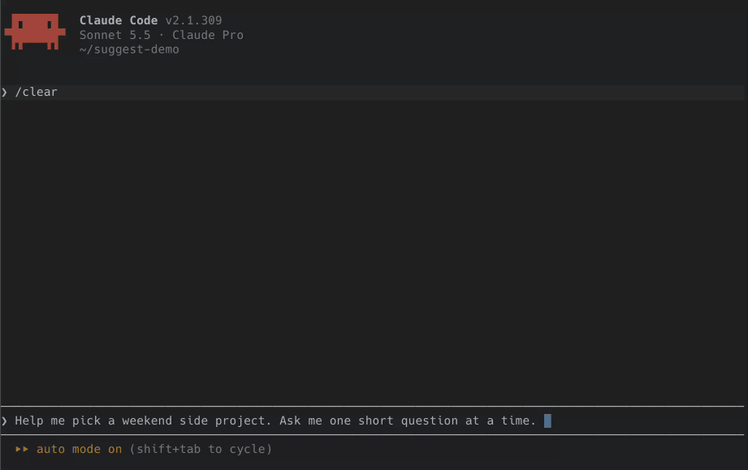

<div align="center">

# Claude Suggest

**Clickable suggested replies for Claude Code.**<br>
When Claude finishes a reply, the answers you'd most likely give show as buttons under it. Click one to send it.

[](https://github.com/dophamine/claude-suggest)
[](https://code.claude.com/docs/en/plugins/mods/overview)
[](LICENSE)

<!-- Demo: add assets/demo.gif and uncomment

-->

</div>

## Why

Most of what you type to Claude between turns is short and predictable: "yes, go ahead", "run the tests",
"option 2", `/compact`. Claude Code already shows one grey guess in the prompt, which Tab accepts.
**Suggest** is a [mod](https://code.claude.com/docs/en/plugins/mods/overview) that turns that guess, plus a
couple more, into buttons under Claude's last message, so answering takes one click.

## Install

Needs **Claude Code 2.1.287 or later**, the release that brought mods; tested on 2.1.309. Mods are early access:
their API may change between releases.

```text
/plugin marketplace add dophamine/claude-suggest
/plugin install suggest@claude-suggest
```

<details>
<summary>From a terminal instead</summary>

```sh
claude plugin marketplace add dophamine/claude-suggest
claude plugin install suggest@claude-suggest
```

If a session is already open, run `/reload-plugins` in it.

</details>

The buttons show in the terminal and in the Desktop app's Code tab. Under Remote Control they show in the
terminal on your machine, not in claude.ai or the mobile app.

## How it works

1. **It remembers the last few messages.** The last 8 of your prompts and Claude's final answers, each cut to
   its last 2,500 characters. Subagent replies, task notifications and scheduled prompts are
   left out. This lives in the session's memory only and is never written to disk.
2. **Claude finishes a turn.** The first button is Claude Code's own grey prompt suggestion, the one Tab accepts.
   It comes from Claude Code itself and costs nothing extra.
3. **It decides whether to ask a model for more.** In `smart` mode (the default) it does so only when the end of
   Claude's reply asks something or offers something: a `?`, or phrases like "should I", "want me to",
   "would you like", "let me know". In `auto` mode it asks after every reply, in `manual` mode never on its own.
4. **A small model writes the rest.** Claude Haiku (by default, at low effort) reads the recent messages, newest
   first, up to 6,000 characters, and returns up to 2 more replies written as you would write them. When the next
   reply isn't clear it returns none, and you keep the one free button. While it works, a dim "more suggestions…"
   line shows. It runs in the background, so the session never waits for it.
5. **The replies are cleaned up.** "Run `/compact`" becomes the bare `/compact`, so clicking it runs it. Duplicates
   and bare numbers are dropped. If Claude Code had no grey suggestion of its own, the model's first reply becomes
   that grey suggestion, so Tab accepts it too.
6. **You click.** A plain reply is sent as your next prompt. A slash command is run, and one that doesn't exist is
   put in the input instead. The dim `✎` next to a reply puts it in the input to edit before you press Enter.
7. **The buttons go away** as soon as you send any prompt, and a late model answer never lands on a newer reply.

## Use

- Click a reply to send it, or `✎` to edit it first.
- `/suggest` shows buttons under Claude's last reply now, in any mode. Nothing is sent to the session.
- `/suggest <hint>` steers them, like `/suggest shorter` or `/suggest about testing`. All buttons then come from the model.
- `/suggest auto`, `/suggest smart` or `/suggest manual` switches the mode.

## Settings

Change them in `/config` (rows starting with "Suggest ›"). The mod reloads with the new values, no restart needed.
In the setup dialog after install, number fields start empty: leave them empty to keep the default.

| Setting | Default | What it does |
| --- | --- | --- |
| `mode` | smart | Claude Code's own suggestion always shows (free). `auto`: extra replies after every reply. `smart`: only when Claude asks or offers something. `manual`: only when you run `/suggest`. |
| `click` | send | `send`: a click sends (✎ fills the input). `fill`: a click fills the input, nothing is sent until you press Enter. |
| `maxReplies` | 3 | Buttons shown, 1 to 5. `1` keeps only Claude Code's own suggestion and makes no model call. |
| `model` | haiku | Model for the extra replies: haiku, sonnet or opus |
| `effort` | low | How hard that model thinks: low, medium, high, xhigh or max |
| `contextChars` | 6000 | How much recent conversation the model reads, 500 to 50,000 |
| `messageChars` | 2500 | Longer messages keep only their last part, 200 to 20,000 |

They're stored in `~/.claude/settings.json` under `pluginConfigs["suggest"].options`.

## Cost

Claude Code's own suggestion is free. Each extra set of replies is one small model call (Haiku at low effort by
default) on your plan or API key. In `smart` mode that's only after replies that ask or offer something. Set
`mode` to `manual` or `maxReplies` to `1` to make none.

## Privacy and safety

To write the extra replies, Suggest sends the recent messages (up to `contextChars`, 6,000 characters by default)
to the model you picked, through Claude Code's own model call, on the same account as your session. Nothing goes
anywhere else: it makes no other network requests, starts no processes, and reads or writes no files. A click sends
only the text on the button, or runs the slash command it names.

To check this yourself, run `claude plugin validate` on the folder: its `calls:` line lists everything the mod asks
Claude Code to do.

## Develop

```sh
git clone https://github.com/dophamine/claude-suggest
cd claude-suggest
claude plugin validate .
claude plugin test .
claude --plugin-dir .
```

Claude Code writes the type declarations to `.claude-plugin/types/` when it loads the folder. Issues and pull
requests are welcome.

## License

[MIT](LICENSE) © Alex Pakhaliuk
